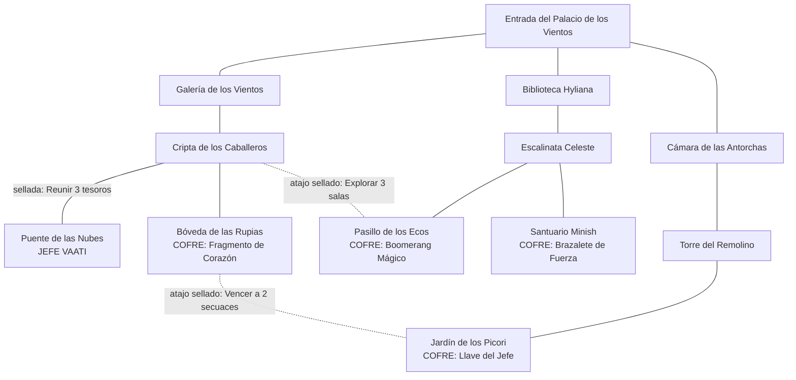
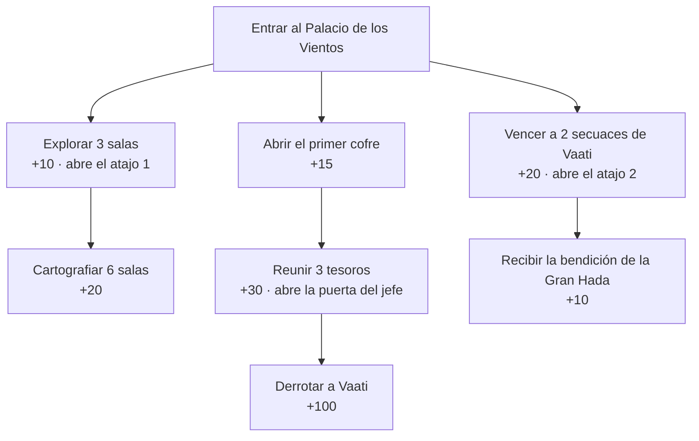

# La Leyenda de Zelda: El Ascenso de Vaati
### Aventura Algorítmica · Checkpoint 3: Mapa como grafo, árbol de misiones y diccionario de estados

> Link entra al **Palacio de los Vientos**, una mazmorra que cambia en cada partida. Vaati se esconde tras una puerta sellada por el viento: para abrirla, Link debe completar las misiones del palacio, descubrir salas, abrir cofres y vencer a sus secuaces. Cada misión cumplida abre atajos que cambian las rutas del mapa.

## Integrantes del equipo

**Equipo 1** · CS2001 Estructura de Datos y Algoritmos · Instituto Kriete de Ingeniería y Ciencias (IKIC)

| Integrante | Usuario de GitHub |
|---|---|
| Alejandro Josué Esperanza Cardoza | [@Hopeelex](https://github.com/Hopeelex) |
| Jonathan Andrés Delgado Chom Him | [@jonathan965](https://github.com/jonathan965) |
| José Arturo Guardado Rivas | [@josearturog54-blip](https://github.com/josearturog54-blip) |
| Fernando Miguel Mejía Jaco | [@fernandomimejia-boop](https://github.com/fernandomimejia-boop) |

Lo que aportó cada integrante está en la sección **8. Aportes del equipo** (Checkpoint 3) y en **Aportes del equipo (Checkpoint 2)**, al final de este archivo.

---

## Cómo ejecutar el juego

**Requisitos:** Python 3.8 o superior. No hay que instalar nada: `collections` y `random` vienen con Python.

```bash
git clone https://github.com/fernandomimejia-boop/The-legend-of-Key-.git
cd The-legend-of-Key-
python main.py
```

Cada módulo también se puede ejecutar solo para ver una demostración de sus funciones y casos límite: `python grafo.py`, `python estado.py`, `python misiones.py`, `python mazmorra.py`, `python historial.py`, `python eventos.py`.

### Estructura del proyecto

```
Aventura-Algoritmica/
├── main.py          # Archivo central: menú, partida e integración de todas las estructuras
├── grafo.py         # CP3 · Grafo genérico (lista de adyacencia) con BFS y DFS
├── misiones.py      # CP3 · Árbol de misiones con recorridos preorden, por niveles y postorden
├── estado.py        # CP3 · Diccionario con el estado del mundo
├── mazmorra.py      # CP2 · Mazmorra recursiva + (CP3) conversión a grafo con atajos
├── historial.py     # CP2 · Pila: historial de acciones y deshacer
├── eventos.py       # CP2 · Cola (deque): eventos del mapa y turnos de combate
├── inventario.py    # CP1 · Lista: inventario de Link
├── exposicion/
│   └── arboles.py   # Exposición de árboles (prototipo del árbol de misiones)
├── docs/
│   ├── evidencia_checkpoint3.txt   # Partida completa del Checkpoint 3
│   ├── evidencia_checkpoint2.txt   # Partida del Checkpoint 2
│   ├── diagrama_flujo_usar_objeto.png
│   └── pseudocodigo_usar_objeto.txt
└── README.md
```

Las funciones no se copian en `main.py`: se importan desde cada módulo, y todas llevan su docstring.

---

## Funcionalidades del juego hasta ahora

| # | Opción del menú | Qué hace | Estructuras |
|---|---|---|---|
| 1 | Moverse a otra sala | Muestra las puertas según el grafo; las selladas no se cruzan. Cada movimiento dispara un evento, descubre la sala, recoge su tesoro y revisa las misiones | Grafo, diccionario, pila, cola, lista, árbol |
| 2 | Ver inventario | Lista los objetos de Link | Lista |
| 3 | Usar un objeto | `usar_objeto` (búsqueda lineal) y registro en el historial | Lista, pila |
| 4 | Deshacer | Revierte la última acción (backtracking real) | Pila, diccionario |
| 5 | Ocarina del Viento | Deshace varias acciones (`deshacer_multiples`) | Pila |
| 6 | Ver historial | Pila de la cima a la base, consulta de la cima y conteos por tipo | Pila |
| 7 | Explorar la sala | Procesa varios eventos seguidos (`procesar_multiples_eventos`) | Cola, diccionario, árbol |
| 8 | Turnos de batalla | Ronda de combate con rotación `popleft` + `append` | Cola |
| 9 | Ruta más corta (BFS) | Ruta con menos saltos a cualquier sala respetando las puertas selladas; si no hay ruta, dice qué misión la abre | Grafo, diccionario |
| 10 | Alcanzables y zonas aisladas (DFS) | Salas a las que se puede llegar ahora y zonas que quedan aisladas tras puertas selladas | Grafo, diccionario |
| 11 | Árbol de misiones | Árbol con sangría (preorden), disponibles por etapa (por niveles) y rupias por rama (postorden) | Árbol, diccionario |
| 12 | Estado del mundo | Salas visitadas, tesoros, enemigos vencidos, rupias y puertas selladas | Diccionario |
| 13 | Salir | Resumen final de la partida | Todas |

Además, al iniciar la partida se generan la mazmorra recursiva, el grafo con atajos y las puertas selladas. Las misiones se completan solas al cumplir su condición: dan rupias y abren puertas.

---

## 1. Mapa como grafo — `grafo.py` y `mazmorra.py`

### Qué parte del juego resuelve

El Palacio de los Vientos es un **grafo no dirigido**: cada sala es un vértice y cada puerta es una arista. El grafo responde tres preguntas del juego:

* **¿Por dónde puede moverse Link?** Las puertas de una sala son los vecinos de ese vértice.
* **¿Cuál es la ruta más corta a una sala?** BFS (opción 9).
* **¿Qué salas puede alcanzar ahora y cuáles quedan aisladas?** DFS y componentes conexas (opción 10).

### Una implementación genérica

`grafo.py` define la clase `Grafo` con **lista de adyacencia** (un diccionario vértice → lista de vecinos). No sabe nada de mazmorras: funciona con cualquier conjunto de elementos relacionados. Su autoprueba (`python grafo.py`) la usa con otro mapa, el de las regiones de Hyrule, para demostrarlo.

| Método | Qué hace | Complejidad |
|---|---|---|
| `agregar_vertice`, `agregar_arista` | Construyen el grafo (sin duplicados ni lazos) | O(1) promedio / O(grado) |
| `vecinos`, `existe_arista` | Consultas seguras (no fallan con vértices inexistentes) | O(grado) |
| `bfs(origen, bloqueadas)` | Recorrido por niveles con una cola `deque` | **O(V + E)** |
| `ruta_mas_corta(origen, destino, bloqueadas)` | Ruta con menos saltos (BFS + padres) o `None` | **O(V + E)** |
| `dfs(origen, bloqueadas)` | Recorrido en profundidad, recursivo | **O(V + E)** |
| `alcanzables(origen, bloqueadas)` | Conjunto de vértices alcanzables (DFS) | **O(V + E)** |
| `componentes_conexas(bloqueadas)` | Zonas aisladas (un DFS por zona) | **O(V + E)** |

Todos los recorridos reciben un conjunto opcional de **aristas bloqueadas**. Así, el mismo grafo responde "¿por dónde se puede pasar ahora?" sin borrar aristas: las puertas selladas viven en el diccionario de estado y se le pasan al grafo.

### ¿Por qué un grafo, por qué lista de adyacencia, y por qué BFS y DFS?

* **Grafo y no árbol:** la mazmorra recursiva del Checkpoint 2 es un árbol, es decir, un grafo conexo sin ciclos, así que entre dos salas hay **un solo camino**. `mazmorra.agregar_atajos()` agrega dos puertas nuevas entre salas que están a 3 saltos o más. Esas puertas crean **ciclos** y, con ellos, **caminos alternativos**. Ya no es un árbol, por eso hace falta un grafo.
* **Lista de adyacencia y no matriz:** cada sala tiene pocas puertas (grafo disperso). La lista ocupa O(V + E) y recorre los vecinos de una sala en O(grado). Una matriz ocuparía O(V²) aunque casi todas sus celdas estuvieran vacías.
* **BFS para la ruta más corta:** BFS explora por niveles (primero las salas a 1 salto, luego a 2…). Por eso, la primera vez que llega al destino lo hace por la ruta con **menos saltos**.
* **DFS para lo alcanzable:** para saber qué hay detrás de cada puerta no importa el orden. DFS baja por un camino hasta el fondo y regresa, visitando cada sala una sola vez. Lanzado desde cada sala no visitada, separa el mapa en **zonas aisladas**.

### Dibujo del grafo (partida de la evidencia)

Líneas sólidas: puertas del árbol recursivo original. Líneas punteadas: los **2 atajos** que forman ciclos. Las etiquetas marcan las **puertas selladas** al empezar y la misión que abre cada una (GitHub dibuja este diagrama automáticamente):



| Puerta sellada al inicio | Tipo | Se abre con la misión |
|---|---|---|
| Cripta de los Caballeros ↔ Puente de las Nubes [JEFE VAATI] | Puerta del jefe | Reunir 3 tesoros |
| Cripta de los Caballeros ↔ Pasillo de los Ecos | Atajo 1 (ciclo) | Explorar 3 salas |
| Bóveda de las Rupias ↔ Jardín de los Picori | Atajo 2 (ciclo) | Vencer a 2 secuaces de Vaati |

12 vértices y 13 aristas: las 11 del árbol original más los 2 atajos. Al iniciar, el juego también imprime la lista de adyacencia completa.

**Ejemplo real de la evidencia:** con el atajo 2 abierto, BFS lleva a Link del Jardín de los Picori al Pasillo de los Ecos en 3 saltos. Por el árbol original serían 6:

```
🧭 Ruta más corta (BFS): 3 salto(s)
    0. Jardín de los Picori [COFRE: Llave del Jefe]
    1. Bóveda de las Rupias [COFRE: Fragmento de Corazón]
    2. Cripta de los Caballeros
    3. Pasillo de los Ecos [COFRE: Boomerang Mágico]
    ¡Un atajo ahorra 3 salto(s)! Por el árbol original serían 6.
```

---

## 2. Árbol de misiones — `misiones.py`

### Qué parte del juego resuelve

Las misiones del palacio **dependen de la anterior**: una misión solo se puede completar cuando su padre está completado. Cada misión tiene una **condición** (por ejemplo, "visitar 3 salas"), una **recompensa** en rupias y, algunas, **una puerta que abren**. Completar una misión cambia la partida: da rupias, abre puertas del grafo y desbloquea a sus hijas.

```
Entrar al Palacio de los Vientos                         (raíz, se completa al empezar)
├── Explorar 3 salas                   +10   abre el atajo 1
│   └── Cartografiar 6 salas           +20
├── Abrir el primer cofre              +15
│   └── Reunir 3 tesoros               +30   abre la puerta del jefe
│       └── Derrotar a Vaati           +100  ¡Hyrule se salva!
└── Vencer a 2 secuaces de Vaati       +20   abre el atajo 2
    └── Recibir la bendición de la Gran Hada  +10
```



8 misiones, altura 3 y 3 hojas. Es la evolución del árbol de la exposición (`exposicion/arboles.py`), ahora conectado a la partida.

### ¿Por qué un árbol?

Cada misión tiene **un solo requisito anterior**, y ese requisito está en un solo lugar: eso es un árbol (cada nodo tiene un solo padre). El árbol hace natural la regla de dependencias: una misión está **disponible** si no está completada y su padre sí lo está. Al recorrerlo, el juego sabe en O(n) qué se puede hacer en cada momento.

### Recorridos que usa el juego (cada uno con un propósito)

| Recorrido | Función | Para qué se usa en el juego | Complejidad |
|---|---|---|---|
| **Preorden** | `imprimir_preorden` | Mostrar el árbol con sangría y el estado de cada misión (opción 11) | O(n) |
| **Por niveles** | `recorrido_por_niveles` | Listar las misiones disponibles por etapa, con su progreso `[1/3]` (opción 11) | O(n) |
| **Postorden** | `recompensa_rama` | Sumar las rupias ganadas y pendientes de cada rama: los hijos se suman antes que el padre (opción 11) | O(n) |

Otras funciones: `misiones_disponibles` O(n), `buscar_mision` O(n), `completar_mision` O(n) (respeta el bloqueo) y `revisar_misiones`. Esta última completa sola toda misión disponible cuya condición ya se cumple, y repite en cascada si al completar una se desbloquea otra.

---

## 3. Diccionario del estado del mundo — `estado.py`

### Qué parte del juego resuelve

Todo lo que cambia mientras se juega y que el juego consulta en cada acción:

```python
estado = {
    "salas": {                                    # clave: nombre de la sala (texto único)
        "Cripta de los Caballeros": {"visitada": True, "tesoro": None, "recogido": False},
        "Bóveda de las Rupias [COFRE: Fragmento de Corazón]":
            {"visitada": True, "tesoro": "Fragmento de Corazón", "recogido": True},
        ...
    },
    "puertas_selladas": {                         # clave: TUPLA ordenada (sala_a, sala_b)
        ("Cripta de los Caballeros", "Puente de las Nubes [JEFE VAATI]"): "Reunir 3 tesoros",
    },
    "eventos": {"enemigo": 3, "rupias": 1, "trampa": 1, "hada": 1},   # clave: tipo de evento
    "rupias": 225,
}
```

### Elección de las claves

* **Sala → nombre de la sala (texto).** El generador nunca repite nombres, así que identifica a cada sala de forma única.
* **Puerta → tupla ordenada `(sala_a, sala_b)`.** Una tupla es inmutable y por eso puede ser clave. Una lista no podría, porque no es *hasheable*. Al ordenarla, la puerta A-B y la puerta B-A son la misma clave.
* **Evento → su tipo** (`"enemigo"`, `"rupias"`, `"hada"`…), para contarlos.

### Operaciones del diccionario en el juego

| Operación | Dónde | Ejemplo |
|---|---|---|
| **Consulta con `.get()`** | `obtener_sala`, `motivo_sello`, `contar_eventos` | `estado["puertas_selladas"].get(clave)` → la misión que abre la puerta, o `None` |
| **Actualización** | `marcar_visitada`, `marcar_tesoro`, `sumar_rupias` | Link entra a una sala: `"visitada": True` |
| **Inserción** | `crear_estado`, `sellar_puerta`, `registrar_evento` | El primer evento de un tipo nuevo: `eventos[tipo] = eventos.get(tipo, 0) + 1` |
| **Eliminación** | `abrir_puerta` | `puertas_selladas.pop(clave, None)` cuando una misión abre la puerta |
| **Funciones propias de resumen y filtro** | `salas_visitadas`, `tesoros_pendientes`, `contar_tesoros_recogidos`, `resumen_estado` | Las misiones revisan `resumen_estado()` para saber si se cumplió su condición |

### ¿Por qué un diccionario?

En cada movimiento el juego pregunta si una puerta está sellada, si una sala ya se visitó y cuántos enemigos venció Link. Con un diccionario (tabla hash) cada consulta es **O(1) en promedio**. Con una lista de salas habría que recorrerla hasta encontrar la que se busca: **O(n)**. Además, nunca se usa `[]` con una clave que podría no existir: se usa `.get()` o `in`, así que no hay `KeyError`.

---

## 4. Integración: cómo trabajan juntas las estructuras

Ninguna estructura funciona sola. Esto es lo que pasa en **un movimiento**:

```
Link elige una puerta (opción 1)
   │
   ├─► ¿Está en el DICCIONARIO de puertas selladas? ── sí ─► "Un muro de viento…" (no se mueve)
   │                                                 no
   ├─► PILA: historial.registrar_accion({"tipo": "Moverse", "desde": A, "hacia": B})
   ├─► COLA: eventos.procesar_siguiente_evento()  ──► DICCIONARIO: registrar_evento(tipo), rupias
   ├─► DICCIONARIO: marcar_visitada(B)
   ├─► ¿Tesoro? ──► LISTA: inventario.agregar_objeto  +  DICCIONARIO: marcar_tesoro  +  PILA: "Recoger"
   └─► ÁRBOL: revisar_misiones(indicadores del DICCIONARIO)
            └─► misión completada ──► DICCIONARIO: sumar_rupias, abrir_puerta (pop)
                                          └─► GRAFO: BFS y DFS ya pueden cruzar esa puerta
```

* **Grafo ↔ diccionario:** el grafo guarda **todas** las puertas. El diccionario guarda **cuáles están selladas** y se las pasa a BFS y DFS como aristas bloqueadas.
* **Diccionario → árbol:** las condiciones de las misiones se revisan con los números del estado del mundo (salas visitadas, tesoros, enemigos, hadas, jefe derrotado).
* **Árbol → diccionario → grafo:** al completarse, una misión elimina una puerta sellada del diccionario. En ese instante BFS encuentra rutas más cortas por el atajo y DFS deja de ver la sala del jefe como zona aislada.
* **Cola → diccionario → árbol:** cada evento procesado (al moverse o al explorar la sala) se cuenta por tipo. Vencer a 2 secuaces completa una misión y abre el atajo 2.

### Decisión: ¿qué pasa con el estado del mundo al deshacer?

**Deshacer revierte la posición de Link y los tesoros recogidos, pero no lo que Link ya descubrió o logró.**

| Al deshacer… | Qué se revierte | Qué se conserva |
|---|---|---|
| Un movimiento | Link vuelve a la sala `desde` (backtracking) | La sala sigue **visitada** y el evento ya vivido no vuelve a la cola |
| Una recolección | El objeto sale del inventario y el diccionario lo marca de nuevo `"recogido": False` | Las **misiones completadas**, sus rupias y las puertas que abrieron |
| Un uso de objeto | El efecto se desvanece | El objeto (no se consume) |

**Por qué:**

1. **Coherencia con el mundo:** la Ocarina devuelve a Link en el espacio, no en el tiempo del mundo. El mapa que ya recorrió sigue en su memoria, el Moblin derrotado no revive y el viento que se disipó no vuelve a sellar la puerta.
2. **Evita trampas:** si deshacer quitara las rupias de una misión, el jugador podría repetir la misión para cobrarla varias veces. Como cada misión se completa **una sola vez**, deshacer y rehacer nunca da recompensas dobles.
3. **El juego siempre se puede terminar:** una puerta abierta nunca se vuelve a sellar, así que deshacer nunca encierra a Link.

La regla de los eventos del Checkpoint 2 se mantiene: un evento procesado se pierde y no vuelve a la cola, para que la cola siga siendo FIFO pura.

---

## 5. Casos límite

El programa **nunca se cierra con un error**: muestra un mensaje claro y sigue.

| Caso límite | Dónde se maneja | Qué pasa |
|---|---|---|
| Texto, vacío, `0`, negativo o fuera de rango en **cualquier** menú | `leer_opcion_numerica` | `int()` dentro de `try/except ValueError` y validación del rango; vuelve al menú |
| Sala, misión o clave que no existe | `Grafo.vecinos`, `estado.obtener_sala`, `misiones.buscar_mision` | Retornan lista vacía, `None` o `(None, None)` con `.get()`; nunca `KeyError` |
| Ruta sin resultado posible | `accion_ruta` + `Grafo.ruta_mas_corta` → `None` | "Ahora mismo no hay ruta…" y qué misión abre la puerta que la bloquea |
| Ruta a la misma sala | `accion_ruta` | "Link ya está en esa sala." |
| Cruzar una puerta sellada (acción no permitida) | `accion_moverse` + `estado.motivo_sello` | "Un muro de viento sella la puerta…"; Link no se mueve |
| Recoger un tesoro ya recogido, completar una misión ya completada o bloqueada (acciones repetidas) | `intentar_recoger_tesoro`, `misiones.completar_mision` | Mensaje de aviso; no se duplica nada |
| Abrir una puerta que ya estaba abierta | `estado.abrir_puerta` | `pop(clave, None)` no falla y retorna `False` |
| Deshacer u Ocarina con el historial vacío | `historial.deshacer_ultima_accion` / `deshacer_multiples` | Avisan y retornan `None` / `[]` |
| Explorar con la cola vacía | `eventos.procesar_multiples_eventos` | "Hyrule está en calma" |
| Aristas repetidas, lazos o vértices inexistentes en el grafo | `Grafo.agregar_arista`, `Grafo.bfs` | Retornan `False` o `[]` |
| `Ctrl+C` o fin de la entrada | `leer_entrada` | Cierre ordenado, sin traceback |
| Consola de Windows o salida redirigida a un archivo | inicio de `main.py` | `sys.stdout.reconfigure(encoding="utf-8", errors="replace")` |

**Pruebas realizadas:** 300 partidas con entradas aleatorias, incluidas entradas inválidas, sin un solo error. Además, en 300 mazmorras distintas un jugador que sigue las rutas BFS siempre logra derrotar a Vaati, así que todas las partidas se pueden ganar.

---

## 6. Resumen de complejidades

| Estructura | Operación | Complejidad | Por qué |
|---|---|---|---|
| Grafo | BFS, DFS, ruta más corta, zonas aisladas | O(V + E) | Cada sala se visita una vez y cada puerta se revisa una vez |
| Grafo | Vecinos de una sala | O(grado) | Lista de adyacencia: solo se miran sus puertas |
| Árbol | Preorden, por niveles, postorden, disponibles, buscar | O(n) | Cada misión se visita una vez |
| Árbol | `agregar_hijo` | O(1) | `append` a la lista de hijos |
| Diccionario | Consultar, insertar, actualizar, eliminar | O(1) promedio | Tabla hash: se va directo a la clave |
| Lista (comparación) | Buscar una sala por nombre | O(n) | Habría que recorrerla elemento por elemento |
| Pila (CP2) | `append` / `pop` | O(1) | Se opera solo en la cima |
| Cola (CP2) | `append` / `popleft` de `deque` | O(1) | `list.pop(0)` sería O(n) |
| Mazmorra (CP2) | Generación recursiva | O(b^d) | b = ramificación, d = profundidad |

---

## 7. Evidencia de ejecución

`docs/evidencia_checkpoint3.txt` tiene el texto completo de la consola de una partida, de principio a fin. Para reproducirla se usó la semilla 32. Muestra:

* la mazmorra recursiva, el grafo con sus atajos y las puertas selladas;
* casos límite (`abc`, `0`, `-1`, `99`, deshacer y Ocarina con el historial vacío, intento de cruzar una puerta sellada y una ruta imposible);
* BFS sin ruta (la puerta del jefe sellada), y después BFS con el atajo, que ahorra 3 saltos;
* DFS con la zona aislada del jefe al principio, y sin zonas aisladas al final;
* las 8 misiones completándose en cascada, con sus rupias y las puertas que abren;
* un deshacer de una recolección y de un movimiento, y la Ocarina deshaciendo 2 acciones;
* el árbol de misiones con sus tres recorridos, el estado del mundo, el historial y una ronda de turnos.

Fragmento del árbol de misiones al final de la partida:

```
=============== MISIONES DEL PALACIO ===============
  [completada] Entrar al Palacio de los Vientos
      [completada] Explorar 3 salas (+10 rupias)
          [completada] Cartografiar 6 salas (+20 rupias)
      [completada] Abrir el primer cofre (+15 rupias)
          [completada] Reunir 3 tesoros (+30 rupias)
              [completada] Derrotar a Vaati (+100 rupias)
      [completada] Vencer a 2 secuaces de Vaati (+20 rupias)
          [completada] Recibir la bendición de la Gran Hada (+10 rupias)

  Completadas: 8 de 8 | Altura del árbol: 3
```

---

## 8. Aportes del equipo (Checkpoint 3)

Los commits de cada integrante están en el historial del repositorio.

* **Alejandro Esperanza:** clase genérica `Grafo` en `grafo.py` (lista de adyacencia, BFS, ruta más corta, DFS, alcanzables y zonas aisladas, con aristas bloqueadas) y la conversión de la mazmorra a grafo con atajos en `mazmorra.py`.
* **Jonathan Delgado:** diccionario del estado del mundo en `estado.py` (claves, `.get()`, inserción, actualización, eliminación y funciones de resumen y filtro) y la clasificación de eventos por tipo en `eventos.py`.
* **Arturo Guardado:** árbol de misiones en `misiones.py` (nodos con condición, recompensa y puerta; recorridos preorden, por niveles y postorden; misiones disponibles y completado en cascada).
* **Fernando Mejía:** integración en `main.py` (menú de 13 opciones, puertas selladas, BFS y DFS en el juego, misiones con efecto, decisión sobre el estado al deshacer), pruebas de casos límite, evidencia y este README.

---

# Checkpoints anteriores

Lo construido en los Checkpoints 1 y 2 sigue funcionando dentro del juego. Las opciones 1 a 8 del menú conservan la misma numeración que en el Checkpoint 2.

## Base del Checkpoint 1

El inventario con listas sigue funcionando, y sus tres funciones se usan dentro de la partida:

* `agregar_objeto` (`append`, O(1)): Link empieza con la **Espada Minish** y la **Pluma de Roc**, y recibe los objetos de los cofres y del jefe.
* `usar_objeto` (búsqueda lineal con `in`, O(n)): opción 3 del menú, **Usar un objeto**.
* `soltar_objeto` (`remove`, O(n)): devuelve un objeto a su cofre cuando se deshace una recolección.

El pseudocódigo y el diagrama de flujo de `usar_objeto` están en `docs/`.

## Aportes del equipo (Checkpoint 2)

* **Alejandro Esperanza:** `historial.py` (pila con `append`/`pop`), `deshacer_multiples` y `contar_acciones_de_tipo`.
* **Jonathan Delgado:** `eventos.py` con `collections.deque`, `simular_turnos` y `procesar_multiples_eventos`.
* **Fernando Mejía:** `mazmorra.py`: la función recursiva `generar_mazmorra`, el marcado de salas profundas, la ramificación variable, la profundidad real, el conteo por nivel y la impresión del árbol.
* **Arturo Guardado:** integración en `main.py` (menú, backtracking, recolección de tesoros), validación de entradas y evidencia de ejecución.


## Checkpoint 2 · Historial de acciones (Pila / LIFO) — `historial.py`

#### Mecánica implementada

El **Libro de Crónicas de Hyrule** registra cada acción importante de Link: moverse de sala, recoger un objeto y usar un objeto. Cada acción se guarda como un diccionario:

```python
{"tipo": "Moverse", "desde": "Pasillo de los Ecos", "hacia": "Torre del Remolino", ...}
{"tipo": "Recoger", "objeto": "Botas de Pegaso", "sala": "Mina de Cristal [COFRE: Botas de Pegaso]"}
{"tipo": "Usar", "objeto": "Pluma de Roc"}
```

Guardar el origen (`desde`) es lo que permite el **backtracking real**: al deshacer un movimiento, Link vuelve físicamente a la sala anterior.

| Función | Qué hace | Operación clave | Complejidad |
|---|---|---|---|
| `registrar_accion` | Apila una acción en la cima | `append()` | O(1) amortizado |
| `deshacer_ultima_accion` | Saca y devuelve la acción más reciente | `pop()` | O(1) |
| `ver_ultima_accion` | Consulta la cima sin sacarla | `historial[-1]` | O(1) |
| `mostrar_historial_completo` | Imprime de la cima a la base | recorrido inverso | O(n) |
| `deshacer_multiples` *(Guía 5)* | "Ocarina del Viento": deshace `n` acciones (**opción 5 del menú**) | `pop()` × n | O(k), k = mín(n, tamaño) |
| `contar_acciones_de_tipo` *(Guía 5)* | Cuenta acciones de un tipo (**opción 6 del menú**: movimientos, recolecciones y usos) | recorrido | O(n) |

#### ¿Por qué una pila (LIFO)?

Deshacer consiste, por definición, en revertir **primero lo último que se hizo**. Si Link camina Entrada → Pasillo → Torre, la única forma coherente de retroceder es Torre → Pasillo → Entrada: el orden inverso exacto en que avanzó. Una pila garantiza ese comportamiento por su propia estructura, porque el último elemento que entra es el primero que sale. Es el mismo principio que usan el botón "Atrás" del navegador o Ctrl+Z en un editor.

Con una cola (FIFO) se desharía la acción más antigua (volver a la entrada desde cualquier punto), lo que rompería la coherencia del recorrido.

#### Complejidad

La cima de la pila es el **final de la lista** de Python:

* **Apilar con `append()` es O(1) amortizado:** la lista reserva memoria extra, así que agregar al final casi nunca requiere mover elementos.
* **Desapilar con `pop()` (sin índice) es O(1):** quitar el último elemento no obliga a desplazar a ningún otro.

Por eso en el módulo **nunca se usan `pop(0)` ni `insert(0, x)`**: ambas operan sobre el inicio de la lista y desplazan todos los elementos, con costo O(n).

#### Fragmento de código relevante

```python
def deshacer_ultima_accion(historial):
    """
    Desapila y devuelve la acción más reciente (la cima de la pila).
    LIFO: pop() sin índice extrae el último elemento añadido.
    Complejidad: O(1).
    """
    if not _es_historial_valido(historial):
        return None

    if len(historial) == 0:
        print("[!] Las arenas del tiempo están quietas: no hay movimientos que deshacer. "
              "El historial está vacío.")
        return None

    accion = historial.pop()
    print(f"[⏳] El tiempo retrocede en Hyrule... Deshaces: {_texto_accion(accion)}")
    return accion
```

---

## Checkpoint 2 · Eventos y turnos (Cola / FIFO con `deque`) — `eventos.py`

#### Mecánica implementada

1. **Cola de eventos del mapa:** al iniciar la partida se encolan 8 eventos temáticos (un Moblin que bloquea el paso, rupias ocultas, una trampa de pinchos, Keese, un Octorok, un Chuchu Rojo, una Gran Hada y la risa de Vaati). **Cada vez que Link se mueve, se procesa el siguiente evento** con `popleft()`.
2. **Sistema de turnos de combate:** Link, un Moblin y un Octorok forman una cola circular. El participante del frente actúa (`popleft()`) y vuelve a formarse al final (`append()`), de modo que todos actúan en orden y la ronda puede repetirse indefinidamente (Round Robin).

| Función | Qué hace | Complejidad |
|---|---|---|
| `inicializar_cola_eventos` | Convierte la lista de eventos en una `deque`, validando cada uno | O(n) |
| `encolar_evento` | Agrega un evento al final | O(1) |
| `procesar_siguiente_evento` | Saca y narra el evento del frente | O(1) |
| `simular_turnos` *(Guía 6)* | Una ronda completa con `popleft()` + `append()` (**opción 8 del menú**) | O(k), k = participantes |
| `procesar_multiples_eventos` *(Guía 6)* | Procesa `n` eventos seguidos, se detiene si la cola se vacía (**opción 7 del menú**) | O(mín(n, tamaño)) |
| `mostrar_cola_eventos` | Muestra los eventos pendientes sin modificar la cola (antes de explorar, opción 7) | O(n) |

#### ¿Por qué una cola (FIFO)?

* **Eventos del mapa:** los eventos representan lo que el destino de Hyrule tiene preparado para Link, en un orden narrativo definido. Deben ocurrir **en el mismo orden en que se programaron**: lo primero que se encola es lo primero que sucede. Eso es exactamente FIFO.
* **Turnos de batalla:** un combate justo exige que nadie actúe dos veces antes de que los demás hayan actuado. Al sacar al participante del frente y devolverlo al final, la cola reparte los turnos de forma equitativa y cíclica, sin necesidad de contadores ni índices.

#### Complejidad: `deque.popleft()` O(1) frente a `list.pop(0)` O(n)

Esta es la razón por la que el módulo usa **obligatoriamente `collections.deque`**:

* **`list.pop(0)` es O(n).** Una lista de Python guarda sus elementos en un bloque **contiguo** de memoria. Al eliminar el primer elemento queda un hueco al inicio, y Python debe desplazar **todos** los elementos restantes una posición a la izquierda. Con 1,000 eventos, cada extracción mueve hasta 999 referencias; vaciar la cola completa costaría O(n²).
* **`deque.popleft()` es O(1).** Una `deque` (*double-ended queue*) está implementada como una lista **doblemente enlazada de bloques**, con referencias directas a ambos extremos. Quitar el primer elemento solo actualiza el puntero del extremo izquierdo; ningún otro dato se mueve en memoria.

| Operación | `list` | `deque` |
|---|---|---|
| Encolar al final | `append()` → O(1) | `append()` → O(1) |
| Desencolar del frente | `pop(0)` → **O(n)** | `popleft()` → **O(1)** |

Como **cada movimiento de Link dispara un `popleft()`**, usar `deque` mantiene el costo de cada turno constante sin importar cuántos eventos tenga el mapa.

#### Fragmento de código relevante

```python
from collections import deque

def procesar_siguiente_evento(cola_eventos):
    """
    Extrae, narra y devuelve el siguiente evento (el más antiguo).
    FIFO: popleft() retira el elemento del frente en O(1), a diferencia de
    list.pop(0), que es O(n) porque desplaza todos los elementos en memoria.
    """
    if not _es_cola_valida(cola_eventos):
        return None

    if len(cola_eventos) == 0:
        print("[🍃] La sala está despejada. Solo se escucha el viento de Hyrule... "
              "No quedan eventos por procesar.")
        return None

    evento = cola_eventos.popleft()
    print(f"[Evento] {_narrar_evento(evento)} (quedan {len(cola_eventos)} evento(s))")
    return evento
```

---

## Checkpoint 2 · Generación de mazmorra (Recursividad) — `mazmorra.py`

#### Mecánica implementada

Al iniciar la partida se genera el **Palacio de los Vientos**, la fortaleza de Vaati, como un **grafo de adyacencia** (diccionario): la clave es el nombre de la sala y el valor es la lista de salas conectadas. Las conexiones son bidireccionales, por lo que Link puede caminar en ambos sentidos.

Adaptaciones de la Guía 7 implementadas:

1. **Marcar las salas más profundas:** al llegar al caso base de profundidad máxima, se concatena al nombre un marcador: la primera sala profunda recibe **`[JEFE VAATI]`** y las demás **`[COFRE: objeto]`**.
2. **Ramificación variable:** con `random.randint(1, 3)` cada sala abre 1, 2 o 3 puertas, así que **cada partida genera una mazmorra distinta**.
3. **Calcular la profundidad real alcanzada:** `calcular_profundidad_real()` (también recursiva).
4. **Contar las salas por nivel:** `contar_salas_por_nivel()` (también recursiva).

La función `crear_mazmorra()` llama a la función recursiva y **garantiza los mínimos del checkpoint** (al menos 7 salas, profundidad real ≥ 2 y un jefe colocado). Si un intento aleatorio genera una mazmorra demasiado pequeña, se vuelve a generar; como respaldo final, se fuerza una ramificación mínima de 2, que asegura 1 + 2 + 4 = 7 salas.

#### ¿Por qué recursividad?

Una mazmorra es una estructura **jerárquica**: cada puerta conduce a una sala que es, a su vez, la entrada de una mazmorra más pequeña. Generar una sala y luego "pedir que se genere el resto" desde cada una de sus puertas es aplicar el **mismo procedimiento a un subproblema más pequeño**: la definición de un problema recursivo. Hacerlo con ciclos obligaría a manejar a mano una pila de salas pendientes; la recursión usa la pila de llamadas de Python para eso, y el código queda más corto y fiel a la forma del árbol.

* **Caso base** (la función retorna sin volver a llamarse):
  * **a)** `profundidad_actual == profundidad_maxima`: la sala está en el nivel más profundo. Aquí se le concatena el marcador `[JEFE VAATI]` o `[COFRE: ...]` y no se abren más puertas.
  * **b)** Se alcanzó el límite de salas o no quedan nombres disponibles: la sala queda como callejón sin salida.
* **Caso recursivo:** se elige al azar cuántas puertas abre la sala (1 a 3); por cada puerta se toma un nombre nuevo, se conecta y se llama a `generar_mazmorra(...)` con `profundidad_actual + 1`. Cada llamada se acerca al caso base porque la profundidad siempre aumenta y los nombres disponibles siempre disminuyen, lo que garantiza que la recursión termina.

#### Complejidad

Sea **b** el factor de ramificación (máximo 3) y **d** la profundidad máxima:

* **Temporal: O(b^d).** En el peor caso se crean 1 + b + b² + … + b^d salas, serie dominada por b^d (además, acotada por `limite_salas`).
* **Espacial: O(b^d)** para el diccionario con todas las salas, más **O(d)** para la pila de llamadas, porque el recorrido es en profundidad y solo hay una llamada activa por nivel.

#### Árbol de la mazmorra

Como la ramificación es aleatoria, cada partida produce un árbol distinto. Este es el árbol que `imprimir_arbol_mazmorra()` mostró en la partida registrada en `docs/evidencia_checkpoint2.txt` (12 salas, profundidad 3). Con la misma semilla, es también el árbol de la evidencia del Checkpoint 3:

```
=============== MAPA DEL PALACIO DE LOS VIENTOS ===============
🏰 Entrada del Palacio de los Vientos  (nivel 0)
├── Galería de los Vientos  (nivel 1)
│   └── Cripta de los Caballeros  (nivel 2)
│       ├── Puente de las Nubes [JEFE VAATI]  (nivel 3)
│       └── Bóveda de las Rupias [COFRE: Fragmento de Corazón]  (nivel 3)
├── Biblioteca Hyliana  (nivel 1)
│   └── Escalinata Celeste  (nivel 2)
│       ├── Pasillo de los Ecos [COFRE: Boomerang Mágico]  (nivel 3)
│       └── Santuario Minish [COFRE: Brazalete de Fuerza]  (nivel 3)
└── Cámara de las Antorchas  (nivel 1)
    └── Torre del Remolino  (nivel 2)
        └── Jardín de los Picori [COFRE: Llave del Jefe]  (nivel 3)
---------------------------------------------------------------
Total de salas: 12 | Profundidad real: 3
  Nivel 0: 1 sala(s)
  Nivel 1: 3 sala(s)
  Nivel 2: 3 sala(s)
  Nivel 3: 5 sala(s)
Salas marcadas (jefe o cofre): 5
===============================================================
```

Se observa la **ramificación variable** (la Entrada abre 3 puertas, la Galería de los Vientos solo 1, la Cripta de los Caballeros 2) y que **solo las salas del nivel más profundo** llevan marcador.

#### Fragmento de código relevante

```python
def generar_mazmorra(mapa, sala_actual, sala_padre, profundidad_actual,
                     profundidad_maxima, nombres_disponibles, estado,
                     limite_salas=15, rama_min=1, rama_max=3):
    # Registrar la sala y su conexión de regreso
    mapa[sala_actual] = []
    if sala_padre is not None:
        mapa[sala_actual].append(sala_padre)

    # CASO BASE (a): nivel más profundo -> se marca con jefe o cofre
    if profundidad_actual >= profundidad_maxima:
        _marcar_sala_profunda(mapa, sala_actual, sala_padre, estado)
        return mapa

    # CASO BASE (b): sin espacio o sin nombres disponibles
    if len(mapa) >= limite_salas or len(nombres_disponibles) == 0:
        return mapa

    # CASO RECURSIVO: ramificación variable (1, 2 o 3 puertas)
    numero_puertas = random.randint(rama_min, rama_max)
    for _ in range(numero_puertas):
        if len(mapa) >= limite_salas or len(nombres_disponibles) == 0:
            break
        nueva_sala = nombres_disponibles.pop()
        mapa[sala_actual].append(nueva_sala)
        generar_mazmorra(mapa, nueva_sala, sala_actual, profundidad_actual + 1,
                         profundidad_maxima, nombres_disponibles, estado,
                         limite_salas, rama_min, rama_max)
    return mapa
```

### Decisión del Checkpoint 2: ¿qué pasa con los eventos al deshacer?

**El evento ya procesado se pierde: no vuelve a la cola.** El poder del viento devuelve a Link a la sala anterior, pero lo que ocurrió en Hyrule ya ocurrió: el Moblin derrotado no revive y la trampa ya se activó. Además, volver a meter el evento obligaría a usar `appendleft`, lo que rompería el orden FIFO, y permitiría "reciclar" eventos favorables moviéndose y deshaciendo. El Checkpoint 3 mantiene esta regla y la extiende al estado del mundo (sección 4).
